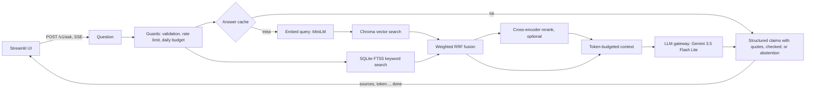

# Advanced RAG: hybrid retrieval, a resilient LLM gateway, and a pre-registered evaluation

Question answering over scientific papers ([Qasper](https://allenai.org/data/qasper)), served as a FastAPI service with streamed, cited answers and a Streamlit client.

- **Retrieval**: vector search (Chroma) plus SQLite FTS5 keyword search, weighted RRF fusion, optional cross-encoder rerank. It is evaluated with a protocol written **before** the test run.
- **Answers**: a gateway to Gemini (`gemini-3.5-flash-lite`) with timeouts, bounded retries, a circuit breaker and typed errors. Long answers are schema-constrained structured output: claims, each citing the passages it relies on with a word-for-word quote. The code checks every citation against the passages that were sent and looks every quote up in its passage. The model may abstain.
- **Service**: async endpoints, Pydantic schemas, answers as server-sent events, per-key rate limits, strict input validation, auto-generated OpenAPI docs.

The interesting result is not a big number. On the held-out test split, hybrid retrieval and semantic chunking did **not** give a reliable gain, and the cross-encoder reranker did, at a latency cost. Every figure below can be traced to a saved run in [docs/CLAIMS_LOG.md](docs/CLAIMS_LOG.md).

- **Evidence rule:** a performance number appears in this README only if it has a row in the claims log (metric, value, run folder, code fingerprint).
- **Scope:** a local demo. One process, one shared bearer token at most, no per-user accounts, and no load test (see [Limitations](#limitations)).

---

## Results (retrieval, test split, run once)

Setup: Qasper **test** split, **292** answerable questions from **124** papers, paper mode (the question's paper is given), retrieval only, `all-MiniLM-L6-v2`, local Chroma store. Metric: nDCG@10 with span-based relevance. Run folder: `runs/eval/20261122T144233Z_3afc204d_test_paper`. The test split was evaluated once (`eval/test_ledger.jsonl`), after the configuration was frozen (`eval/test_freeze.json`). Dev-split numbers are for development only and are not quoted here.

| Arm | Chunking | Retrieval | Reranker | nDCG@10 |
|---|---|---|---|---|
| A | recursive | vector only | no | 0.430 |
| **D (frozen, served)** | recursive | hybrid (RRF k=60, weights 1.0 / 0.7) | no | **0.456** |
| F | semantic | hybrid (RRF) | no | 0.463 |
| G | recursive | hybrid (RRF) | cross-encoder, top 20 | 0.514 |

Pre-registered comparisons (5,000 paper-clustered bootstrap resamples, Holm correction over the 3 comparisons):

| Comparison | Difference in nDCG@10 | Clustered 95% CI | Verdict |
|---|---|---|---|
| A vs D (vector-only vs hybrid) | A - D = -0.027 | [-0.051, -0.002] | not significant after Holm (p = 0.0320) |
| F vs D (semantic vs recursive chunks) | F - D = +0.006 | [-0.012, +0.024] | not significant (p = 0.5035) |
| D vs G (without vs with reranker) | D - G = -0.058 | [-0.084, -0.031] | **significant after Holm** (p = 0.0004), G is higher |

Other metrics for the frozen configuration D: MRR 0.434, HitRate@5 0.682, EvidenceRecall@10 0.705, EvidenceF1@5 0.210.

Retrieval latency, CPU only (no GPU, 4 logical CPUs), excluding any LLM call:

| Configuration | p50 | p95 |
|---|---|---|
| D (served) | 60 ms | 286 ms |
| G (D + rerank), total | 1,242 ms | 1,942 ms |
| G, rerank stage only | 1,191 ms | 1,848 ms |

**What I took from it.** The reranker is the only significant gain, but it costs about 1.2 s per query on this CPU, so it is a per-request switch (off by default) rather than part of the frozen configuration. The dev split had not shown a reranker gain and the test split did, so the dev result did not predict the test result.

**Generation (answer quality) is not validated.** The only run is exploratory (40 dev questions, no baseline, an uncalibrated judge) and it used an earlier generator (Groq `openai/gpt-oss-120b`), not the Gemini model configured now. No number from it is published here, and it says nothing about the current generator.

---

## How it works



- **Ingestion** ([rag/ingestion.py](rag/ingestion.py), [scripts/ingest.py](scripts/ingest.py)): offset-preserving chunking, deterministic chunk ids, incremental upserts, an ingest signature that refuses a store built with different chunking code, and a post-run check that the vector and lexical indexes hold the same ids.
- **Retrieval** ([rag/retriever.py](rag/retriever.py), [rag/fusion.py](rag/fusion.py)): one `Retriever` class used by both the service and the evaluation runner, so the evaluated system is the served system. Reports per-stage latency.
- **Generation** ([rag_core/](rag_core)): `LLMGateway` with a per-call timeout, bounded retry with backoff and jitter, a circuit breaker, and typed errors. It accepts an ordered provider list (failover only before the first streamed token), but only Gemini is configured, so no failover is in use. The long answer is requested with a per-request JSON schema whose source ids are exactly the ids that were sent ([rag_core/claims.py](rag_core/claims.py)); a reply that does not follow it is reported as invalid output and the passages are shown instead. Prompts are versioned with a local fallback. Only complete, cited, non-degraded answers are cached; the cache key includes the retrieval config, index version, embedder revision, prompt hash and model.
- **Safety and cost**: prompt-injection escaping of questions and passages, a daily answer budget, per-key rate limits, masked tracing by default. API keys are read from the environment only and are never logged. The injection tests ([test_prompt_injection.py](tests/unit/test_prompt_injection.py), [test_rag_core_prompts.py](tests/unit/test_rag_core_prompts.py)) check the trust boundaries around the model; they do not show that a real model resists an injection.
- **Tracing**: optional OpenTelemetry tracing ([rag_core/otel_tracing.py](rag_core/otel_tracing.py)), exported over OTLP to Langfuse, which shows it as an LLM trace, and optionally to any other OTLP backend (`tracing.exporters`). Generation spans carry the OpenTelemetry GenAI attributes. The tracer is wrapped so that a tracing failure can never change an answer.
- **API** ([api/](api)): FastAPI over the same `RagService`; see [API](#api).
- **App** ([app/](app)): Streamlit with chat, evaluation, observability and about tabs. It is a **client of the API**: it opens no index and holds no model or key ([app/remote.py](app/remote.py) adapts the API to the interfaces the UI uses). The evaluation tab reads only `app_data/results.json`, which is built from the claims log and refuses a number with no run folder.

## API

Interactive docs at `/docs` (OpenAPI at `/openapi.json`) once the server is running. Errors are `{"error": {"code", "message"}}`.

| Method and path | What it does |
|---|---|
| `POST /v1/ask` | the answer as server-sent events: `sources`, then `token` events, then `done` (the full `AnswerResult`); a typed `error` event may precede `done` |
| `POST /v1/answer` | the same pipeline as one JSON body (`AnswerResult`) |
| `POST /v1/retrieve` | retrieval only: the best passages, no model call |
| `POST /v1/feedback` | a thumbs up or down for an answer (saved locally, forwarded to Langfuse when the answer was traced) |
| `GET /v1/health` | liveness |
| `GET /v1/ready` | readiness with the self-check (index, models, keys) |
| `GET /v1/meta` | what is running, the limits and the daily budget |
| `GET /v1/observability` | the shared Langfuse metrics snapshot |

- **Order of checks for a query:** authentication, readiness, per-key rate limit (429), question validation (422), daily budget. A question over the daily budget is still answered with HTTP 200: the retrieved passages and a `daily_budget_reached` error, never a model call.
- **Rate limiting** ([api/limits.py](api/limits.py), `slowapi`): keyed by the `X-Session-Id` header when it is a well-formed id, else by client address. `ask`, `answer` and `retrieve` share one bucket per key; feedback has its own. The numbers come from `app.*` in [config.yaml](config.yaml). Limits are in memory and per process.
- **Validation** ([api/schemas.py](api/schemas.py)): request bodies refuse unknown fields; paper, session, request and trace ids must be plain tokens; bodies over 16 KB are refused before they are read. Control and invisible characters are removed from the question.
- **Authentication:** none by default. Set `ADVRAG_API_TOKEN` on the server to require `Authorization: Bearer <token>` on everything except `/v1/health`.

Example (the stream arrives token by token):

```powershell
curl.exe -N -X POST http://127.0.0.1:8000/v1/ask -H "Content-Type: application/json" -d '{\"question\": \"What dataset do they use?\"}'
```

## Evaluation method

Written down before the test run in [eval/PREREGISTRATION.md](eval/PREREGISTRATION.md) (its sha256 is checked by the runner):

- Dev/test split by **paper**, not by question.
- Arms, metrics, comparisons and the decision rule fixed in advance; deviations are appended, never rewritten.
- The test split runs only with an explicit flag and a frozen config, and is recorded in a ledger. It has been run once.
- Paired, paper-clustered bootstrap with Holm correction ([eval/compare.py](eval/compare.py)).
- Retrieval evaluation calls only `Retriever.retrieve`: no LLM, no network.

## Quick start (Windows, local)

Requires Python 3.13. The environment below follows the standing rules in [CLAUDE.md](CLAUDE.md): a venv outside OneDrive, packages from the configured index, and models loaded from the local HuggingFace cache only (pinned revisions in [config.yaml](config.yaml); the code never downloads them).

```powershell
python -m venv "$env:LOCALAPPDATA\advrag\venv"
& "$env:LOCALAPPDATA\advrag\venv\Scripts\python.exe" -m pip install -r requirements.lock
& "$env:LOCALAPPDATA\advrag\venv\Scripts\python.exe" -m pip install -e . --no-deps

# one-time: build the index for the recursive strategy (incremental; never clears a collection)
$env:CHROMA_LOCAL_PATH = "$env:LOCALAPPDATA\advrag\chroma_v2"
& "$env:LOCALAPPDATA\advrag\venv\Scripts\python.exe" scripts\ingest.py --strategy recursive

# 1) start the API (opens the index and loads the models; set GEMINI_API_KEY in the environment or in .env to enable answers)
& "$env:LOCALAPPDATA\advrag\venv\Scripts\python.exe" -m uvicorn api.main:app --host 127.0.0.1 --port 8000
#    docs: http://127.0.0.1:8000/docs    readiness: http://127.0.0.1:8000/v1/ready

# 2) in a second terminal: the Streamlit UI, a client of the API
& "$env:LOCALAPPDATA\advrag\venv\Scripts\python.exe" -m streamlit run app\streamlit_app.py
```

Without a Gemini key the API still retrieves and the app shows the passages. If the UI cannot reach the API it shows an error screen with the failed check. Keep the API bound to 127.0.0.1 unless `ADVRAG_API_TOKEN` is set.

### Configuration

Settings live in [config.yaml](config.yaml). Environment variables (values are never printed; `.env.example` lists names only):

| Variable | Read by | Purpose |
|---|---|---|
| `ADVRAG_INDEX_DIR` or `CHROMA_LOCAL_PATH` | API | folder of the Chroma store (no default: nothing opens a store you did not name) |
| `GEMINI_API_KEY` | API | answers (every LLM call uses `gemini-3.5-flash-lite`) |
| `LANGFUSE_PUBLIC_KEY`, `LANGFUSE_SECRET_KEY`, `LANGFUSE_BASE_URL` | API | optional tracing and metrics |
| `ADVRAG_API_TOKEN` | API and UI | optional shared bearer token |
| `ADVRAG_API_URL` | UI | where the API is (default `http://127.0.0.1:8000`) |
| `APP_ACCESS_CODE` | UI | optional access code for the page |

### Tests

```powershell
pytest --fast -p no:cacheprovider -q -rs   # everyday run, skips tests marked slow
pytest -p no:cacheprovider -q -rs          # full run, more Hypothesis examples
```

The suite is hermetic: it blocks non-loopback network access and `chromadb.CloudClient`, and uses fake providers instead of real keys.

## Docker

`compose.yaml` runs the API and the UI from one image. The build uses public PyPI at the locked versions plus PyTorch's public CPU wheel index; it needs no credentials. The image holds code and packages only: models, the index and API keys are supplied at run time.

```bash
# once: build the index into the data volume (needs the pinned embedding model in your HuggingFace cache)
docker compose run --rm --build ingest

# API on http://127.0.0.1:8000/docs, UI on http://127.0.0.1:8501
docker compose up --build

docker compose down        # stop (the index stays in the volume)
```

- **Models:** the host's HuggingFace cache is mounted read-only. The default is `~/.cache/huggingface`; set `HF_CACHE_DIR` to the folder that holds `hub/` if yours is elsewhere (on Windows usually `%USERPROFILE%\.cache\huggingface`). The containers run offline and never download. Without the pinned reranker the app still runs, with reranking unavailable.
- **Keys:** put `GEMINI_API_KEY` (and optionally the Langfuse names, `ADVRAG_API_TOKEN`, `APP_ACCESS_CODE`) in your shell or a `.env` file; only the names listed in `compose.yaml` reach a container. Without a Gemini key retrieval works and no answer is generated. `docker compose config` prints the values, so check the file with `docker compose config --quiet`.
- Ports are published on `127.0.0.1` only (`API_PORT`, `UI_PORT` change them).
- An index built on the host cannot be reused: ingest manifests record the store location, and the API checks it.

## Repository map

| Path | What it holds |
|---|---|
| [rag/](rag) | chunking, embedders, lexical (FTS5) index, fusion, retriever, reranker, ingestion |
| [rag_core/](rag_core) | answer path: service, gateway, prompts, structured claims, cache, tracing (OpenTelemetry) |
| [api/](api) | FastAPI service (SSE streaming, schemas, rate limits) and its Python client |
| [db/](db) | local Chroma store wrapper |
| [app/](app) | Streamlit app (a client of the API) |
| [eval/](eval) | pre-registration, runners, metrics, paired comparison, datasets and the split |
| [scripts/](scripts) | ingestion, lexical index build, artifact builder, diagnostics |
| [tests/](tests) | unit and property tests |
| [docs/](docs) | the claims log and working notes |
| [PROJECT_CONTEXT.md](PROJECT_CONTEXT.md) | decision log: why each choice was made and what it costs |

## Limitations

- **Generation is not validated.** The only answer-quality run is exploratory (40 dev questions, no baseline, an uncalibrated judge) and used an earlier generator. Behaviour on unanswerable questions has not been measured, so the hallucination rate is unknown. The offline judge (`gemini-3.8-flash`) is a different model from the generator but the same family (Gemini), so self-preference is still possible.
- **One process, one retrieval lock.** The retriever (SQLite, the embedder) is serialised by one lock, so concurrent questions queue at retrieval. Rate limits and the daily budget are in memory and per process. There is a single optional shared token and no accounts. No concurrency or load test exists.
- **Prompt injection** is handled by escaping and delimiting untrusted text and by validating what comes back (the structured answer, its citations and quotes, abstention). That is tested with scripted providers; it has not been measured against a real model.
- **Corpus scale.** The corpus is small (200 papers). Behaviour at a larger scale has no saved measurement.
- **Semantic chunking** did not beat recursive chunking on the test split. The served index uses recursive chunks.
- **Reranker** is off by default because of its latency on CPU.
- **Docker** was built and run on Apple Silicon (linux/arm64) without API keys; a live answer and the reranker were not exercised in a container. There is no CI workflow yet.
