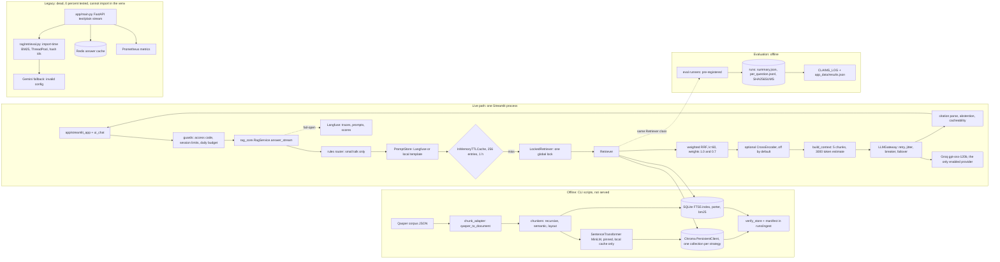
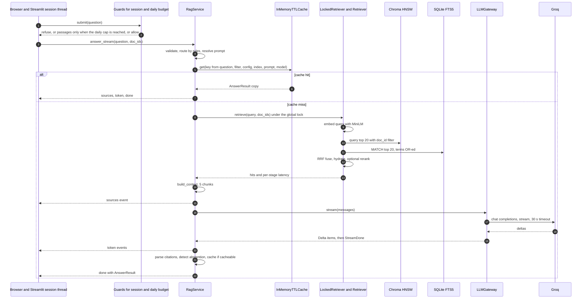
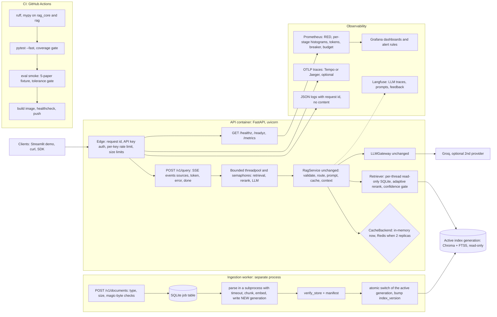

# 02 — Architecture Review

Evidence tags as in `03`: **[V]** read in code · **[T]** test or saved artifact · **[M]** AUDIT MEASUREMENT (reproduced in `06` Appendix A; not a run artifact, do not quote without a proper run) · **[R]** reasoned, not verified.

## 1. The existing system in one picture

The repository holds four things that are easy to confuse: the **offline ingestion** scripts, the **live path** (one Streamlit process), the **offline evaluation** harness (which calls the *same* `Retriever` class as the app), and a **dead legacy server** that all your original claims came from.

## 2. Lifecycle

### 2.1 Request lifecycle (live path)

### 2.2 Lifecycle map: your stated pipeline against the code

| Step | Where | Status | Evidence / gap |
|---|---|---|---|
| Document upload | none | ❌ | No endpoint or UI. Corpus is a JSON file passed to `scripts/ingest.py` |
| Parsing | `rag/chunk_adapter.py` (Qasper JSON → `Document`) | 🟡 | PDF/DOCX/HTML/MD/XLSX loaders exist (`rag/loaders.py`) but are legacy, untested, unwired |
| Chunking | `rag/chunkers.py`, `rag/splitting.py`, `rag/tokens.py` | ✅ | Offset-native recursive splitter proven equal to LangChain's; token-window cap with the real tokenizer; property tests |
| Embedding | `rag/embedders.py` | ✅ | MiniLM pinned (`1110a243…`), lazy, `local_files_only`; **15.7 chunks/s** batch on 4 CPUs [M]; 9.3 chunks/s end-to-end in the saved ingest manifest [T] |
| Indexing | `db/store.py`, `rag/lexical.py`, `rag/ingestion.py` | ✅ | Two stores kept in parity, verified after every run; deterministic ids; reverse-order upsert |
| Query processing | `rag_core/service.py` | 🟡 | Validate (500 chars), rules router (small talk), prompt resolution. No rewriting or decomposition |
| Retrieval | `rag/retriever.py` | ✅ | Vector + FTS5, sequential by design, filter parity |
| Fusion | `rag/fusion.py` | ✅ | Weighted RRF, deterministic ties |
| Reranking | `rag/rerankers.py` | 🟡 | Pinned cross-encoder; off by default; 1.19 s p50 [T] |
| Context construction | `rag_core/context.py` | ✅ | Labelled `S1..Sn`, 5 chunks, truncation of an oversized first chunk |
| LLM generation | `rag_core/gateway.py` | ✅ | Groq only; Gemini built and disabled |
| Response streaming | `app/ui_chat.py` → `st.write_stream` | 🟡 | Typed event stream in-process; **no network streaming API** |

### 2.3 How the components talk to each other

Everything is wired with small protocols and dataclasses, which is why the tests can inject fakes without monkey-patching: `Retriever(store, embedder, lexical, reranker)` → `RetrievalResult(hits, latency_ms)`; `RagService(retriever, gateway, cache, cfg, prompts, tracer)` → a stream of plain-dict events and a final pydantic `AnswerResult`; `LLMGateway(providers)` → `Delta…` then `StreamDone`; `CacheBackend`, `PromptStore`, `VectorStore`, `LexicalIndex` are `Protocol`s. `app/bootstrap.py::Factories` is the single place that builds real objects. This is the strongest architectural property of the project, and it is what makes the "extract an API later" plan credible.

## 3. Component-by-component review

| Component | Files | Strengths | Weaknesses | Verdict |
|---|---|---|---|---|
| Ingestion | `rag/ingestion.py`, `scripts/ingest.py` | Incremental by `doc_version`; ingest signature refuses a mismatched store; verification with vector/lexical id parity and a seeded round-trip sample; manifest per run | Qasper-only input; `verify_store` loads every chunk (N-10); a **no-op re-run still takes 37.0 s (recursive) / 42.1 s (semantic)** for 7K chunks [T: `runs/ingest/*/manifest.json`]; two stores are consistent by *verification*, not by a transaction | Keep; generalise input; make verification streaming |
| Chunking | `rag/chunkers.py`, `splitting.py`, `tokens.py` | Offsets *computed*, never searched; hard token cap from the real tokenizer; property-tested; 0 of 435,269 characters uncovered [T] | Semantic boundary detector flawed (N-07); semantic ≈ recursive on TEST | Keep recursive; fix or retire semantic |
| Embeddings | `rag/embedders.py` | Pinned, lazy, offline-only; asymmetric API ready | No query-embedding cache on the live path (the 512-entry LRU is legacy); 256-token / 384-d model | Fine for the scale shown |
| Vector store | `db/store.py` | One collection per strategy; cosine; state collection for the signature; `delete_by_doc` is the only deletion | Embedded Chroma is intended for a single process **[R: not tested]**, so an API and a separate ingestion worker cannot safely share it; `doc_ids()`/`get_all()` are O(N) | Keep to ≈ 1M vectors; see §7 |
| Lexical | `rag/lexical.py`, `lexical_query.py` | Persistent FTS5 + bm25, porter; `chunk_map` gives O(log N) delete; escape function makes injection into MATCH impossible | OR-of-all-terms; **the `doc_id` filter does not prune the scan** (§7); one connection | Keep; fix pruning (N-08) |
| Fusion | `rag/fusion.py` | 25 lines, 100% covered, deterministic | Weights/`k` chosen by design, not tuned at scale | Keep |
| Retriever | `rag/retriever.py` | Dependency-injected; filter parity tested; fused list never unbounded; per-stage latency; identical class in eval and app | Sequential legs (documented, measured); no confidence gate (N-02) | Keep |
| Reranker | `rag/rerankers.py` | Pinned revision, lazy, CPU | 1.19 s p50 (1.85 s p95); 69% covered; not adaptive | Make it adaptive (P1-4) |
| Router | `rag/router.py` | Conservative allowlist; whole-message match | Handles small talk only | Fine |
| Context | `rag_core/context.py` | Order preserved; never empty (truncates first chunk); 100% covered | Budget is an estimate; no neighbour expansion | Keep; add expansion (P2-5) |
| Prompts | `rag_core/prompts.py`, `prompt_store.py`, `prompt_sync.py` | Escaping of all untrusted text; versioned and hashed; fetched prompts validated; local fallback | Fetch failure not remembered (N-13) | Keep; add a breaker |
| Gateway | `rag_core/gateway.py` | Retry/backoff/jitter, half-open breaker, no splice, typed errors, attempt records | N-06, N-15; one live provider | The best module in the repo |
| Service | `rag_core/service.py` | Typed events, error → event never crash, cacheability rules, ≤ 8 trace observations | `index_version` fixed at start (N-12) | Keep |
| Cache | `rag_core/cache.py` | Key covers every answer-changing input; copy-in/copy-out; thread-safe | In-process; no single-flight | Keep; add a Redis backend only for replicas |
| Tracing | `rag_core/tracing.py`, `scores.py`, `observability_reader.py` | Fail-open, masked by default, daily cap, tests | SaaS dependency; 150 traces/day; feedback needs a trace (N-16) | Keep; add metrics/logs (N-09) |
| App | `app/*` | Self-check screen, access gate, abuse caps, artifact-only Evaluation tab | Global lock (N-01); per-session limits (N-05); no health endpoints | Demo-grade; extract an API |
| Evaluation | `eval/*`, `rag/eval_metrics.py` | Pre-registered, paper-level split, ledger, clustered bootstrap, Holm, determinism check, fingerprints | Generation eval exploratory; no CI gate; question-weighted cluster estimand | The differentiator; add CI gate |
| Legacy | `app/main.py`, `cache/`, `observability/metrics.py`, `rag/retrieval.py`, … | (historical) | Dead, untested, advertised | Delete or quarantine (P0-2) |

## 4. Failure behaviour: what happens when each dependency fails

| Dependency | Failure | Behaviour today | Evidence | Gap |
|---|---|---|---|---|
| Groq | 429 / 5xx / timeout before the first token | Retry ≤ 3× with exponential backoff + jitter, honouring `Retry-After` (capped 8 s); then next provider (none enabled) → `AllProvidersFailed` → **degraded result: the retrieved passages plus a notice** | `test_rag_core_gateway.py` | No second provider live |
| Groq | Fails after text was streamed | `MidStreamError`; partial answer shown with a `mid_stream` error; **never retried or spliced; never cached** | tests; `is_cacheable` | none |
| Groq | 3 consecutive failed calls | Breaker opens 30 s: all requests degrade without calling the provider; one half-open trial | `CircuitBreaker` tests | Empty/`length` responses count (N-06) |
| Groq | 400/413/422 | Not retried; does **not** open the breaker (a user cannot trip it with a bad request) | test `…never_opens_the_breaker` | none |
| Groq | Missing/invalid key | `auth` error, counts toward the breaker; the self-check warns on *presence* only | `bootstrap._finish` | Invalid key shows as degraded answers |
| Chroma | Exception in `query` | `retrieval_failed` error event, degraded "search unavailable" result | `service._pipeline` | No retry, no breaker, no replica |
| SQLite FTS5 | Exception, or stall under the global lock | Same as Chroma; a stall blocks every session (N-01) | [V] | Lock timeout |
| Index drift (vector ≠ lexical count, manifest mismatch) | At start-up | **Fatal self-check**: the app refuses to serve an unverified store | `build_resources` | Checked only at start |
| Embedding model missing | At start-up | Fatal self-check; the app never downloads | `model_cached` | none |
| Langfuse | Down / no keys / quota | Tracing fail-open; scores dropped; prompt falls back to the local template | `SafeTracer`, `LangfusePromptStore` | Up to 2 s added per request (N-13) |
| Redis | n/a | Not in the live path (legacy `cache/cache.py` fails open, untested) | [V] | none |
| Process restart | Always | In-memory cache and **daily budget reset** (cost guard weakens) | `DailyBudget` docstring | Persist the counter |
| Overload | Many sessions | Threads queue behind the lock; no load shedding or timeout | [V] | 503 + `Retry-After` |

## 5. Observability architecture today

* **Traces:** Langfuse span tree (`rag.request → route → cache.hit|miss → retrieve → context → generation`), ≤ 8 observations per request, `masked` capture (keys, emails, URLs and long numbers redacted; no passage text), 150-traces/day cap. **[T]** 97.5% covered with fakes; the live SaaS path is exercised only by owner-run smoke scripts.
* **Metrics:** none on the live path. The `Retriever` returns per-stage `latency_ms`, and `AnswerResult` carries latency, tokens and attempts, but nothing aggregates them. Prometheus definitions exist only in the dead legacy module.
* **Logs:** none (by rule, to protect keys). Failures are visible only in the UI, in Langfuse, or in `AnswerResult.attempts`.
* **Dashboards/alerts:** the Observability *tab* reads the Langfuse Metrics API once per hour (quota-bound). No Grafana, no alert rules.

## 6. Architectural bottlenecks (ranked)

1. **No service boundary**, so no auth, no streaming API, no health checks, no horizontal scaling.
2. **Global retrieval lock + embedded single-process stores**: serialises users and forbids a separate ingestion process (embedded Chroma cannot be opened by two processes safely **[R]**).
3. **Lexical leg cost grows with corpus size and ignores the document filter's selectivity** (§7).
4. **Ingestion cost**: embedding dominates (9.3 chunks/s end-to-end [T]); verification is O(N) on every run.
5. **State in process memory** (cache, daily budget): fine for one process, wrong for two.
6. **No operational telemetry** without Langfuse.

## 7. Scale analysis: 100 → 10,000 → 100,000 → 1,000,000 documents

**Unit of account.** Your corpus: 200 Qasper papers → 7,255 recursive chunks, i.e. **36.3 chunks per paper** [T]. Real PDFs usually produce more chunks per document, so read "documents" as "Qasper-sized papers".

**What was measured [M]** (synthetic copies of your real corpus in a throw-away SQLite file in `%TEMP%`; 105 answerable dev questions; limit 20; same `SqliteFtsIndex` code; copies inflate rare-term posting lists, so treat the numbers as indicative, not exact):

| Docs | Chunks | FTS5 file | Default query, corpus-wide p50 / p95 / max | Default query, **single-paper filter** p50 / p95 / max | Stopword-filtered, corpus-wide p50 / p95 |
|---|---|---|---|---|---|
| 200 | 7,347 | 21 MB | 23.8 / 32.8 / 104 ms | 15.1 / 17.4 / 18 ms | 8.4 / 16.2 ms |
| 2,000 | 73,470 | 132 MB | 170.7 / 253 / 349 ms | 115.2 / 241 / 961 ms | 93.9 / 187 ms |
| **10,000** | **367,350** | **545 MB** | **1,068 / 3,488 / 31,121 ms** | **589 / 915 / 1,346 ms** | **574 / 1,558 ms** |

Three conclusions follow, and the second is not obvious from the code:

1. **Lexical latency is roughly linear in corpus size** (×50 docs → ×45 p50).
2. **The `doc_id` filter does not make single-paper search cheap.** The scaling is measured **[M]**; the mechanism is stated in your own `rag/lexical.py` docstring (FTS5 `UNINDEXED` columns cannot be looked up by index), so the `doc_id IN (...)` clause is evaluated *after* the MATCH has produced its candidates. A question about *one* paper (your primary task) went from 15 ms to 589 ms as the corpus grew 50×, while the answer set stayed ~37 chunks. At 10K docs the paper-mode retrieval p50 would rise from ≈ 60 ms to roughly 0.6 s **from the lexical leg alone**.
3. **Dropping stopwords only buys a constant factor** (≈ 2×); it does not change the slope.

**Fix, in order of cost:** (a) resolve the document's `rowid`s from `chunk_map` (indexed by `doc_id`) and constrain the FTS query to them, or index `doc_id` as a token column and AND it into the MATCH; (b) cap query terms by IDF; (c) beyond a few million chunks or concurrent writers, move lexical search to a real engine (that is the first point at which "OpenSearch/Tantivy/Postgres FTS" has a technical justification).

**Ingestion time [T] + [M] + extrapolation:** saved manifests show 7,255 chunks in **781.8 s** end-to-end (9.3 chunks/s); batch embedding alone measured **15.7 chunks/s**. Linear extrapolation (not measured at those sizes): 10K docs ≈ 6.5 h (embedding only) to ≈ 11 h end-to-end on this 4-core laptop CPU; 100K docs ≈ 2.7 to 4.6 days; 1M docs ≈ 27 to 46 days. A no-op verification re-run is 37 s at 7K chunks ≈ 31 min at 367K (O(N)).

| Scale | Docs → chunks | Vector RAM (384-d × 4 B) | What breaks first | Technically justified response |
|---|---|---|---|---|
| **100** | ≈ 3.6K | ≈ 6 MB | Nothing | Nothing |
| **10,000** | ≈ 367K (the measured row above) | ≈ 560 MB + graph | Lexical leg (§7 table), ingestion hours, O(N) verify | Index-assisted doc filter + IDF-capped terms; streaming verify; embedding on GPU/ONNX or a batch API; read-only per-thread SQLite |
| **100,000** | ≈ 3.6M | ≈ 5.6 GB + graph | HNSW RAM on a 16 GB machine; FTS file ≈ 5 GB; linear extrapolation puts the default lexical query at ≈ 10 s | Immutable index generations; sharding by tenant/collection; consider Postgres (pgvector + FTS) *if* you need one system with ACID filters |
| **1,000,000** | ≈ 36M | ≈ 56 GB | Everything single-node | A dedicated vector/search service (Qdrant/OpenSearch-class), distributed ingestion; at this point infrastructure is justified |

**Not measured (say so in interviews):** Chroma HNSW query latency beyond 7K vectors, filtered-HNSW behaviour, RAM at scale, process start-up time, concurrent throughput. The load-test plan in `06` §3 covers them.

## 8. Target architecture

**Keep:** the `rag_core` boundary, Chroma + FTS5 (to ≈ 1M chunks), MiniLM pinned, the gateway, the cache key design, Langfuse for LLM traces and prompts, the evaluation framework, Streamlit as a demo client.
**Replace:** the dead FastAPI/Redis/Prometheus modules (delete), `LockedRetriever` (per-thread read-only connections + semaphores), ad-hoc config (pydantic-settings, `extra="forbid"`), in-process rate limits (per-key limits in the API).
**Add:** an HTTP service, immutable index generations for ingestion, metrics/logs/OTLP, Docker + CI, load tests.
**Do not add:** Kubernetes, Kafka, Celery, Elasticsearch. Redis only when a second API replica exists.

**Why immutable index generations for ingestion.** Embedded Chroma is designed for a single process (I did not test multi-process access **[R]**), and your own design already refuses to serve an unverified store. So the worker never edits the live store: it builds a *new* generation directory, runs the existing `verify_store`, and the API flips an "active generation" pointer (and `index_version`, which invalidates cache keys correctly). This reuses the manifest/signature machinery you already have, gives rollback for free, and avoids both multi-process Chroma access and a new database. Reconsider only if you want multiple writers.

**Target request lifecycle.** Client → edge (id, auth, limit) → `RagService` (validate, route, prompt, cache) → retrieval under a bounded semaphore (read-only SQLite per thread) → optional rerank under a latency budget → context → gateway → SSE. Every stage has a timeout and returns a typed error; overload returns `503 + Retry-After`.

**Target failure handling.** Per-stage timeouts, bulkheads (separate semaphores for retrieval, rerank, LLM), a breaker around the prompt fetch and each store, no retries on non-idempotent work, ingestion idempotent by `doc_version`, graceful drain on shutdown, readiness false while the active generation fails verification.

**Deployment.** One VM or a single `docker compose up`: `api`, `ui` (Streamlit calling the API), `prometheus`, `grafana`, optional `redis` and `tempo`. Model cache and index generations are mounted volumes; `.env` is supplied via compose secrets/env. CI builds the same image.
