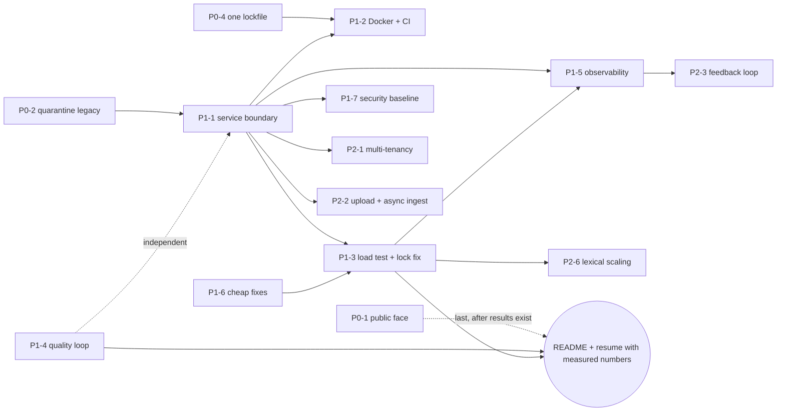

# 05 — Improvement Roadmap (ranked by return on time)

**Principles.** (1) Evidence first: every item ends in a saved artifact (a run folder, a CI log, a dashboard JSON) that can be cited in `docs/CLAIMS_LOG.md`, which is how you already work. (2) Five excellent items beat twenty shallow ones. (3) Nothing here needs Kubernetes, Kafka, Celery or Elasticsearch; each of those is explicitly *not* recommended until a measured trigger appears (`04` §5). (4) Effort figures are my estimates in engineering hours, including tests and the write-up, for someone who already knows this codebase.

Priority meaning: **P0** fundamental (credibility, reproducibility, secrets) · **P1** high impact on production readiness · **P2** differentiation · **P3** optional.

---

## 1. The five highest-ROI improvements

| Rank | Improvement | Why it ranks here | The artifact an interviewer can open | Hours |
|---|---|---|---|---|
| **1** | **Service boundary** (FastAPI + SSE over the existing `RagService` events, auth, rate limit, health, request ids) and removal of the dead legacy server | The single biggest hole for a GenAI *engineer* role. Your `rag_core` already emits typed events (`sources`, `token`, `error`, `done`), so the API is mostly wiring | `serve/` + contract tests + a recorded `curl -N` SSE session in the README | 18–24 |
| **2** | **Reproducible deployment + CI** (Dockerfile, compose, one lockfile, GitHub Actions with a coverage gate and an eval smoke test) | Converts "works on my machine" into "clone, `docker compose up`, green badge". Cheap relative to its signalling value | A green workflow run; `docker compose up` reaching `/readyz` | 14–20 |
| **3** | **Load and capacity test**, plus replacing the global retrieval lock | Answers "how many users?" with a number you measured; fixes the honest QPS/QPM problem for good | `runs/load/…` with p50/p95/p99, error rate, knee-point QPS; a capacity note | 12–18 |
| **4** | **Close the quality loop**: adaptive reranking under a latency budget, retrieval-confidence gate, false-answer rate on the 48 unanswerable questions, calibrated judge, deterministic context precision/recall | Your best measured result (reranker) is unused; your most important safety number is unmeasured | A new pre-registered run folder + CLAIMS_LOG rows | 24–32 |
| **5** | **Live-path observability**: Prometheus RED + per-stage histograms, JSON logs with request ids, OTLP option, committed Grafana dashboard + alert rules, cost accounting | Replaces the discredited v1 Prometheus/OTel claims with true ones; the `Retriever` already returns per-stage latency | Dashboard JSON, a screenshot generated from the load test, alert rules | 12–16 |

Total for the five: **80–110 h**. With P0 and the cheap P1 fixes: **110–140 h**.

---

## 2. P0: Critical (do these first, about 12–16 h)

| ID | Improvement | Current → missing | Files affected | Technical approach | Effort | Impact | Interview value |
|---|---|---|---|---|---|---|---|
| P0-1 | **Make the public face true** | README is `UNVERIFIED`/all-TBD, placeholder CI badge, "ChromaDB Cloud", broken Quick Start; `resume_bullets_v2.md` still carries +44%, 1.7 s, +12.6 s, "~14 QPS" → one honest README (architecture, run commands that work, the TEST table copied *from* `CLAIMS_LOG.md`), remove or relocate career files (`resume_bullets_v2.md`, `prompt.txt`) from the repo | `README.md`, `Makefile`, `resume_bullets_v2.md`, `prompt.txt` | Wait until P1 results exist so the README can cite them; until then strip numbers and dead commands. Relocate career files outside the repo. *(You asked me not to rewrite the README now; this is the plan for later.)* | 3–4 | Very high | A recruiter's first 90 seconds decide whether the rest is read |
| P0-2 | **Quarantine the dead legacy code** | 13 measured modules (≈ 1,060 statements) at 0% coverage plus the root `streamlit_app.py` and legacy scripts, advertised by README/Makefile, cannot import → delete or move to `legacy/` with a one-line note; update `test_import_guard.py` and the CLAUDE.md rules that name them | `app/main.py`, `cache/`, `observability/metrics.py`, `rag/retrieval.py`, `rag/pipeline.py`, `rag/ingest.py`, `rag/embeddings.py`, `rag/context_builder.py`, `db/vectordb.py`, root `streamlit_app.py`, `eval/run_eval.py`, `run_ablation.py`, `feature_contrib.py`, `scripts/run_evaluation.py`, `scripts/ingest_qasper.py` | The v1 snapshot already exists, so deleting is recoverable. **Needs your approval** (CLAUDE.md rule 1 spirit). Do it before P1-1 so names do not clash | 4–6 | High | Coverage of what remains rises to ≈ 93%; no broken entry points |
| P0-3 | **Secrets hygiene** | `.env` inside a OneDrive-synced folder with legacy cloud credentials → move to `%LOCALAPPDATA%\advrag\.env`, delete unused variables, rotate anything that was synced | `.env`, `rag_core/env.py` call sites | `load_env(path=…)` already exists; add `ADVRAG_ENV_FILE` | 1 | Medium-high | "How do you manage secrets?" has a clean answer |
| P0-4 | **One dependency truth** | `requirements.txt` polluted; `pyproject` incomplete; `docs/env_baseline.txt` is the real freeze → generate `requirements.lock` from the real import graph with extras (`serve`, `eval`, `dev`), delete the junk, fix hatch config | `requirements.txt`, `pyproject.toml`, `requirements-eval.txt` | `uv pip compile`/`pip-tools`; verify with a clean venv `pip install` + `python -c "import rag_core, app"` | 3–4 | High | Prerequisite for P1-2 |

## 3. P1: High impact (about 100–125 h)

| ID | Improvement | Current → missing | Files affected | Technical approach | Effort | Impact | Interview value |
|---|---|---|---|---|---|---|---|
| P1-1 | **Service boundary** *(top-5 #1)* | No HTTP API; sync, single-process → FastAPI app: `POST /v1/query` (SSE events = existing dicts), `GET /healthz`, `GET /readyz` (reuse self-check), API-key auth (hashed keys), per-key token-bucket limit, request-id middleware, pydantic request/response models reusing `AnswerResult`, lifespan (open stores, warm-up, close SQLite), graceful drain | new `serve/`; refactor `app/bootstrap.py::build_resources` into a Streamlit-free `rag_core/bootstrap.py` | Run the sync `RagService` generator in a bounded threadpool (`anyio.to_thread` + semaphore, 503 when full); `text/event-stream` with `event:`/`data:` framing and a final `done`; contract tests with `httpx` + the existing fakes (`tests/unit/rag_core_fakes.py`); Streamlit becomes a client or keeps calling in-process | 18–24 | Very high | The first thing a hiring manager asks to see |
| P1-2 | **Deployment + CI** *(top-5 #2)* | No container/CI → multi-stage Dockerfile (python 3.13-slim, non-root, `HEALTHCHECK`, model cache mounted read-only), `docker-compose.yml` (api, optional Prometheus + Grafana, volume for Chroma + FTS5), `.github/workflows/ci.yml` (ruff, mypy on `rag_core` + `rag`, `pytest --fast` with a ≥ 90% live-path coverage gate, clean-install job, `pip-audit`, an eval smoke test on a 5-paper fixture) | `Dockerfile`, `docker-compose.yml`, `.github/workflows/`, `pyproject.toml` | Cache the HuggingFace model in the image build only with your approval (CLAUDE.md rule 11: never download without asking); CI uses the hash embedder fixtures that tests already have | 14–20 | Very high | Reproducibility is the cheapest credibility there is |
| P1-3 | **Load test + concurrency fix** *(top-5 #3)* | No load test; global lock (N-01) → Locust scenarios (a) fake LLM, to isolate retrieval at 1/2/4/8/16 users, (b) real LLM, small, within Groq limits, (c) open-loop arrival; thread-local read-only SQLite connection, 2-thread safety test for MiniLM + Chroma, bounded semaphore for the cross-encoder, lock timeout | `loadtest/locustfile.py`, `rag/lexical.py`, `app/bootstrap.py` (or the new service), `docs/CLAIMS_LOG.md` | Report **QPS (not QPM)** with p50/p95/p99, error rate, and the knee; capacity model via Little's law (`L = λW`); every number in a run folder with the code fingerprint | 12–18 | Very high | "How many users?" becomes answerable |
| P1-4 | **Quality loop** *(top-5 #4)* | Reranker unused; no abstention measurement; judge uncalibrated → (a) adaptive rerank on a score-margin trigger, optionally ONNX/int8 cross-encoder; (b) retrieval-confidence gate; (c) false-answer / false-abstain rate on the 48 unanswerable dev questions; (d) context precision/recall of used sources from `gold_spans`; (e) 50–100 human labels → judge agreement; finish RAGAS on n ≥ 100 | `rag/retriever.py`, `rag_core/service.py`, `eval/run_generation_eval.py`, `eval/answer_metrics.py`, a **new pre-registration** | Pre-register first (CLAUDE.md rule 19), run on dev, freeze, run TEST once. Keep claims at what the CIs allow | 24–32 | Very high | Directly addresses "is it accurate and safe?" |
| P1-5 | **Observability** *(top-5 #5)* | Langfuse-only, sampled 150/day; no metrics, no logs → Prometheus RED + per-stage histograms (`Retriever.latency_ms`), token counters (prompt/completion/reasoning), breaker-state and daily-budget gauges, JSON logs with `request_id` (no content), optional OTLP, committed Grafana dashboard and alert rules, cost with configured `prices` labelled "shadow cost" | new `serve/metrics.py`, `serve/logging.py`, `deploy/grafana/`, `deploy/prometheus/`, `config.yaml` (`generation.prices`) | Prometheus client in the API process; alerts on p95 latency, error ratio, breaker open, budget exhausted; a screenshot generated from the P1-3 load run | 12–16 | High | Replaces the v1 claims with true ones |
| P1-6 | **Cheap live-path fixes** | N-06 (`length` classified as provider failure), N-12 (stale `index_version`), N-13 (prompt-fetch negative cache), N-14 (typo-tolerant config), N-15 (stream deadline), N-16 (feedback dropped) | `rag_core/gateway.py`, `rag_core/service.py`, `rag_core/prompt_store.py`, `rag_core/config.py`, `rag_core/scores.py` | Each is a small change with a test that fails first (your mutation-check habit) | 8–10 | Medium-high | Shows you read your own code adversarially |
| P1-7 | **Security baseline + injection eval** | Escaping exists; no measured attack success rate → API-key hashing, CORS lock-down, request-size limits, `bandit`/`pip-audit` in CI, and a 30-passage prompt-injection set run against the real model offline (attack success rate with CI) | `serve/`, `eval/`, CI | Public Qasper text with injected instructions; report success rate, not "we escape it" | 10–14 | High | "How do you handle prompt injection?" gets a number |

## 4. P2: Differentiation (about 70–100 h; pick two or three)

| ID | Improvement | Current → missing | Files affected | Approach | Effort | Impact | Interview value |
|---|---|---|---|---|---|---|---|
| P2-1 | **Multi-tenancy** | None → `tenant_id` on chunks and FTS5, key→tenant map, mandatory server-side filter at the `Retriever` boundary, per-tenant cache key and quota | `rag/schemas_ingest.py`, `db/store.py`, `rag/lexical.py`, `rag/retriever.py`, `serve/` | Build on filter parity; add a property test "no hit from another tenant" (Hypothesis) | 16–24 | High | Strong: cheap *because* of your tested filter parity |
| P2-2 | **Upload + async ingestion** | CLI only → `POST /v1/documents`, SQLite job table, separate worker process, status endpoint, file-type/size/zip-bomb limits, generic `Document` adapter (PDF via PyMuPDF first), idempotent via `doc_version` | `serve/`, new `ingest_worker/`, `rag/ingestion.py` (generalise `qasper_to_document`), `rag/loaders.py` (rewrite, tested) | No Celery/Kafka: a job row plus a worker process is enough for one node. Measure ingest throughput in the load report | 20–28 | High | Completes the upload → parse → index lifecycle |
| P2-3 | **Feedback → regression set** | Thumbs to Langfuse only → local feedback table, export of thumbs-down questions to a review queue, weekly eval | `rag_core/scores.py`, `serve/`, `eval/` | Keep content masking; only public text | 8–12 | Medium | Closes the loop |
| P2-4 | **Fix or retire the semantic chunker** | N-07 measured → embed single paragraphs, compare to a running centroid or percentile breakpoints; pre-registered arms; or present as a documented negative result and retitle the README | `rag/chunkers.py`, `eval/` | Plot similarity series first; if no gain on dev, stop | 8–12 | Medium | Honest ablation story |
| P2-5 | **Neighbour expansion** | None → fetch ±1 chunks of top hits, measure context recall | `rag/retriever.py`, `rag_core/context.py` | One extra `get_chunks` call (ids are deterministic by index) | 10–14 | Medium | Real RAG-quality lever |
| P2-6 | **Lexical scaling fix** | N-08 → stopword/IDF-pruned queries by default, scale benchmark at 10K/100K docs | `rag/lexical.py`, `rag/lexical_query.py` | Keep quality neutral on dev; report latency vs corpus size | 8–12 | Medium | The scale story with numbers |
| P2-7 | **Redis cache/limits (only with a 2nd replica)** | In-process → `RedisCache` behind `CacheBackend`, shared limiter | `rag_core/cache.py`, `serve/` | Add only when compose runs two API containers | 8–12 | Low-medium | Justified, not decorative |
| P2-8 | **Shadow-mode A/B** | Offline arms only → run arm B silently on live questions and compare | `serve/`, `eval/compare.py` | No traffic split needed | 10–14 | Medium | Honest online comparison |

## 5. P3: Optional (adds complexity without proportionate value *today*)

Agentic retrieval · query decomposition/rewriting (until chat memory exists) · semantic cache (until traffic exists) · context compression (prompts are ≈ 1.1K tokens) · model routing (until prices and a measured quality delta exist) · document version history · Kubernetes · a second vector store. Each has a stated trigger in `04` §3.

---

## 6. Dependencies between items

## 7. Suggested order (about 6 weeks at 15–20 h/week)

| Week | Work | Exit criterion |
|---|---|---|
| 1 | P0-2, P0-3, P0-4, P1-6 | Clean-venv install works; legacy gone; tests green; secrets moved |
| 2 | P1-1 | `curl -N` streams SSE; `/readyz` green; contract tests pass |
| 3 | P1-2, P1-7 | Green CI badge; `docker compose up` reaches `/readyz`; injection ASR reported |
| 4 | P1-3 | Load report in `runs/load/…`; global lock replaced; QPS with p95 |
| 5 | P1-4 | New pre-registration → dev run → frozen → TEST once; CLAIMS_LOG rows |
| 6 | P1-5, then P0-1 | Dashboard + alerts committed; README and resume rewritten from CLAIMS_LOG only |

**Projected scorecard (my estimate, not a measurement; same weights as `01`):** Backend 3.5 → 7.5, DevOps 2 → 7.5, Performance evidence 4.5 → 7, Reliability 6.5 → 7.5, Security 5 → 6.5, Docs/claims 5 → 8, RAG 7 → 7.5, LLM 7 → 7.5, Evaluation & observability 7.5 → 8.5, Testing 8.5 → 9 gives a weighted **7.6 / 10**, a solid Level 3 profile. P2 items then buy differentiation (multi-tenancy, upload) rather than basic credibility.

## 8. Acceptance criteria (targets to commit to *before* you measure, not predictions)

* API: 0 failed requests at 8 concurrent users for 5 minutes with a fake LLM; p95 end-to-end ≤ 2.5 s with the real model at 4 concurrent users; 503 (not a hang) when the pool is full.
* CI: live-path coverage ≥ 90%; no new `print()` in `rag/`, `rag_core/`, `serve/`; a clean install in ≤ 5 minutes.
* Quality: no TEST-split regression greater than the pre-registered tolerance; false-answer rate reported with a 95% CI; judge agreement reported before any faithfulness number is quoted.
* Observability: every alert rule has a documented trigger test (a load or fault-injection run that fires it).
