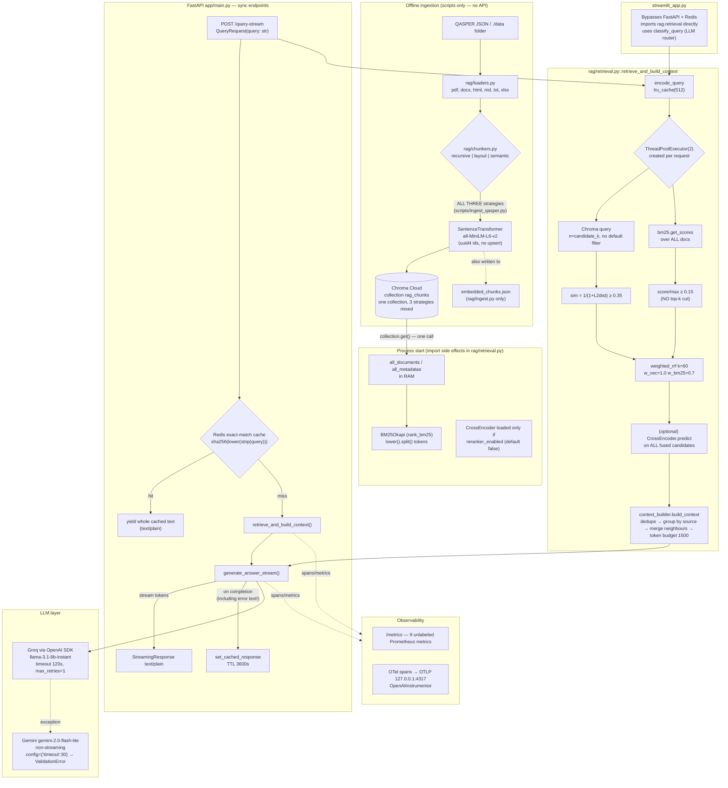
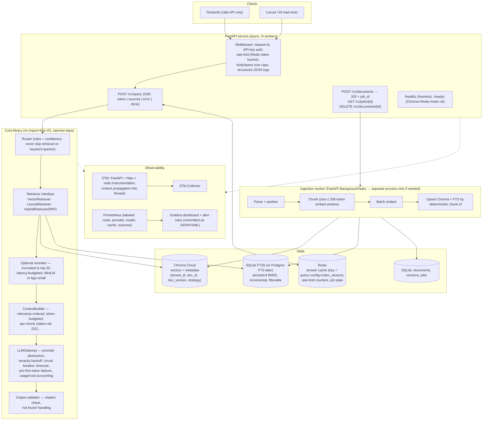

> **UNVERIFIED: written before the rebuild. Do not quote. See docs/CLAIMS_LOG.md.**

# 02 — Architecture Review

All paths are relative to the repo root. Line numbers refer to the files as audited.

---

## 1. Existing system as built

### 1.1 Architecture diagram

### 1.2 Actual request lifecycle (what really happens)

1. **Upload → Parsing → Chunking → Embedding → Indexing.** There is **no upload path in the service**. Ingestion is `python scripts/ingest_qasper.py` (which first calls `clear_collection()`, wiping the index) or `python -m rag.ingest` over `./data`. Neither updates the in-memory BM25; the API must be restarted to see new data.
2. **Query.** `/query-stream` → Redis lookup (exact normalised string) → on miss `retrieve_and_build_context` → `generate_answer_stream` → tokens streamed and concatenated → `set_cached_response`.
3. **Router.** `classify_query` is **not called by the API**. It is only used by Streamlit and by `RAGPipeline`, which nothing in the service imports.
4. **Retrieval.** Embed (LRU) → parallel Chroma + BM25 → threshold filters → weighted RRF → (reranker only if loaded at import) → context builder → top-5 sources.
5. **Generation.** One user message containing `SYSTEM:` text, the question and the context. Groq streams. On exception Gemini is attempted (it fails, see L-01) and a failure string is yielded.

### 1.3 How components communicate

All in-process function calls, with global module-level singletons (`collection`, `bm25`, `groq_client`, `reranker`, `embedding_model`) created at import time. No dependency injection, no interfaces. Redis and Chroma are the only network hops besides LLM calls.

---

## 2. Claim verification matrix

Legend: **1** = verified in implementation · **2** = verified by automated tests · **3** = verified by evaluation results · **4** = partially implemented · **5** = not implemented · **6** = cannot be verified from the repository.

| # | Claim | Class | Evidence and discrepancies |
|---|---|---|---|
| 1 | Hybrid BM25 + ChromaDB | **1, 3** (with **4** for prod path) | Implemented in `retrieve_and_build_context` (`rag/retrieval.py:736`). The benchmark measures a *different* implementation (`RAGRetriever`). In production BM25's corpus is whatever `collection.get()` returns at import (see R-02: Chroma Cloud caps results at 300 — documented limit, behaviour on `get()` unverified). |
| 2 | Parallel retrieval via ThreadPoolExecutor | **1** | `rag/retrieval.py:821`. **Not benchmarked** (no sequential-vs-parallel comparison; the eval harness is sequential). A new pool is created per request. OTel context is not propagated into the worker threads, so those spans become orphan root spans. |
| 3 | RRF with k=60 | **1, 2** | `weighted_rrf` + `cfg.pipeline.rrf_k=60`. It is *weighted* RRF (1.0 / 0.7), not plain RRF. Tests don't assert k=60 specifically or ranking order after fusion. |
| 4 | Semantic chunking with sentence embeddings + cosine | **4** | It's **paragraph-level** (split on blank lines), not sentence-level. Docs claim spaCy sentence segmentation, which does not exist. It embeds 7-paragraph sliding windows, and MiniLM truncates at 256 tokens (see I-02), so the cosine boundary signal is misaligned. |
| 5 | Automatic small-chunk merging | **4** | Implemented but **drops content** when the combined size would exceed `max_chunk_chars` (reproduced; `rag/chunkers.py:155-170`). The test for it uses `min_chunk_chars=10`, which exercises nothing. |
| 6 | Token-budgeted context construction | **1** | `rag/context_builder.py` (tiktoken `cl100k_base`, a proxy for Llama tokens). Budget is hard-coded to 1500 at the call site (`retrieval.py:1007`) while the default is 4000. No tests. Truncation uses `break`, which can return an empty context if the first chunk exceeds the budget. |
| 7 | Two-tier cache (in-process LRU + Redis) | **4** | Two separate caches: query-embedding LRU and Redis answer cache. No in-process tier in front of Redis. No tests. |
| 8 | Embedding cache with 512 entries | **1** | `functools.lru_cache(maxsize=cfg.embedding.lru_cache_size)`, config = 512. Module-level `_cache_hits/_cache_misses` are dead. `embedding.cache_enabled` and `cache_dir` in `config.yaml` are unused. |
| 9 | Streaming FastAPI via SSE | **4** | Streaming works (`StreamingResponse`). It is **not SSE**: `media_type="text/plain"`, no framing, no event types, no error channel. |
| 10 | Groq LLaMA 3.1 8B primary | **1** | `PRIMARY_MODEL="llama-3.1-8b-instant"` hard-coded at `retrieval.py:119` (comment says "config-driven"). Provider/model availability in 2026 is unverifiable from here. |
| 11 | Gemini fallback | **4 (defective)** | Code path exists. `config={"timeout": 30}` fails pydantic validation on the pinned SDK (reproduced), so the fallback has never produced an answer in this configuration. Also non-streaming and untested. |
| 12 | Query routing: regex + LLM | **1, 2 (regex only)** | `classify_query` at `retrieval.py:238`. Not wired into the API. The ≤3-words-no-"?" rule routes keyword queries like "BERT architecture" to *direct* (no retrieval → hallucination risk). Adds one LLM round-trip to most queries. |
| 13 | Prometheus instrumentation | **1** | 9 metrics, `/metrics` endpoint. No labels, default buckets, no token or cost metrics, no dashboards, and `LATENCY_SAVED` uses a hard-coded 6.0 s baseline (`main.py:308`). |
| 14 | OpenTelemetry distributed tracing | **4** | Spans and OTLP exporter exist. Hard-coded `127.0.0.1:4317`, no `service.name` resource, no FastAPI instrumentation (no root request span), no thread propagation, single process so not "distributed". `openinference-instrumentation-openai` is imported but absent from `requirements.txt` and `pyproject.toml`. |
| 15 | Custom eval with Recall@5 and MRR | **1, 3** | Two diverging implementations (`eval/run_eval.py` uses prod retrieval; `scripts/run_evaluation.py` uses its own). Relevance = lexical F1 ≥ 0.25 (see §4.2). |
| 16 | 4-config ablation on 100 QASPER questions | **4** | 100 questions / 93 papers ✔. The four *measured* arms are Vector-Only, Hybrid-no-RRF (**bug ⇒ identical to vector**), Hybrid+RRF, Full. The README's A–D table is **not** what was measured: A (recursive+vector) was never run, and `eval/run_ablation.py` can't reproduce it (the `chunking` override is never read by retrieval, and the reranker is `None` unless enabled at startup). |
| 17 | +44% Recall@5 vs vector-only | **6 — not supported** | Baseline is an estimate (0.1875). Measured vs vector-only: +28.6% rel / +6 pp. See `01_EXECUTIVE_SUMMARY.md` §3. |
| 18 | P50 retrieval latency ≈ 1.7 s | **Contradicted by 3** | Measured P50 retrieval 0.505–0.551 s. 1.68 s is the mean end-to-end including the LLM, in a run whose raw data isn't in the repo. The `docs/` also claim "<200 ms" retrieval and "~50 ms parallel FAISS+BM25" (a FAISS system that no longer exists). |
| 19 | Cache-hit latency < 50 ms | **6** | No benchmark. Histogram measures Redis GET only. Plausible on localhost, unverifiable on managed Redis. |
| 20 | CrossEncoder overhead ≈ 12.6 s on CPU | **Contradicted by 3** | Derived by subtraction. Measured reranker means: 11.714 s (bge-reranker-base, 06-19) and 2.994 s (06-15). The documented MiniLM model was never the benchmarked one. |

**Units check (QPS vs QPM).** `Throughput (QPM)` = `60 / avg_total_latency` for one sequential client: 60/14.284 = 4.2 ✔ arithmetic; 60/4.196 = 14.3 ✔. It is not a benchmark of throughput. There are no concurrent clients, so it says nothing about capacity. Also, 4.2 QPM ≈ 0.07 QPS and 14.3 QPM ≈ 0.24 QPS. The same label covers two runs that differ 3.4× because the *LLM* was slower, not the retrieval. Never convert these into a "QPS" claim.

---

## 3. Component-by-component review

| Component | Verdict | Main issues |
|---|---|---|
| `rag/loaders.py` | Adequate prototype | `source` = absolute file path (leaks FS layout). `load_md` merges front-matter *after* `source` and `file_type`, so a document can spoof them. No size limits, no OCR/table handling. `load_html` only reads sibling nodes after `h1–h3`, so nested layouts yield empty sections. |
| `rag/chunkers.py` | Needs rework | Embedding model loaded at import (a second copy besides `embeddings.py`). Semantic logic flaws (I-01, I-02 in `03_CODE_REVIEW.md`). Layout chunker has no size cap (xlsx sheet = one chunk; Chroma max document = 16,384 bytes). Hard-coded `chunk_size=1000`. |
| `rag/embeddings.py` | OK but dated | `generate_embeddings` encodes one chunk at a time (no batching) and writes a multi-hundred-MB JSON. `uuid4` IDs make ingestion non-idempotent. |
| `db/vectordb.py` | Thin | `clear_collection()` rebinds module global `collection`, but `rag/retrieval.py` did `from db.vectordb import collection`, so it keeps the *deleted* collection object. All adds are single big calls (Chroma Cloud max 300 records/write). No upsert/delete-by-doc. Collection created without `hnsw:space`, so distance is squared-L2 by default and `sim=1/(1+d)` is not cosine. |
| `rag/retrieval.py` | Core, overloaded | 1,000-line module that holds clients, config, routing, prompt, generation, RAGAS, fusion and retrieval. Import has network side-effects (Chroma, model download). |
| `rag/context_builder.py` | Good idea, subtle bugs | Merge step reorders by source/`chunk_id`, which destroys relevance order. Adjacent-`chunk_id` merging is wrong when several strategies share a `source`. `print()` instead of logging. |
| `cache/cache.py` | Best-engineered module | Pool, timeouts, fail-open. Issues: `KEYS` in `flush_cache` and `cache_size` (O(N), blocks Redis), no negative caching rules, no tenant/config in key, JSON double-encode of a string. |
| `app/main.py` | Prototype | Sync endpoints, `print`, no auth, no limits, text/plain, error text cached, 127.0.0.1 OTLP hard-coded, `/` is "health". |
| `observability/*` | Basic | `logging.basicConfig` at import. Plain text (not JSON), no request IDs. Metrics unlabeled. |
| `eval/` + `scripts/run_evaluation.py` | Strong skeleton, weak validity | See `06_BENCHMARKING_STRATEGY.md`. |
| `tests/` | Thin | ~35 tests over chunkers, RRF and router regex. One test fails by construction (`dict >= 0`, `tests/unit/test_retrieval.py::test_latency_is_non_negative`). Tests importing `rag.retrieval` need live Chroma and LLM client construction at import. |
| `streamlit_app.py` | Good demo | Bypasses API/cache. Renders chunk text and titles with `unsafe_allow_html=True` and no escaping (HTML/JS injection from ingested documents). The "Reranker" toggle silently no-ops when the model wasn't loaded at startup (it warns, but only once per query). |
| Packaging | Broken | `pyproject.toml` lacks `tiktoken`, `pymupdf`, `pandas`, `python-frontmatter`, `markdown-it-py`, `beautifulsoup4`, `python-docx`, `openpyxl`, `openinference-*`, `langchain-huggingface`. `requirements.txt` is a polluted freeze (`nipype`, `nibabel`, `kubernetes`, `spacy`, `unstructured`, `fitz==0.0.1.dev2` which conflicts with PyMuPDF, `pathlib==1.0.1` which shadows the stdlib, `frontend`, …) and still lacks the two imports above. |

---

## 4. Architectural bottlenecks and design risks

### 4.1 Retrieval path

1. **Fusion output is not truncated.** BM25 keeps every doc with `score/max ≥ 0.15` (no top-k). All of them go to RRF and then to the reranker (`retrieval.py` ~906–975). Reranker latency scales with corpus size, not `candidate_k`. This alone plausibly explains 3–12 s CPU reranking.
2. **O(C×N) candidate resolution.** For each BM25-only candidate, the code scans `all_documents` comparing `hash(doc)` (`retrieval.py:926-935`). Python caches string hashes, so the constant is small, but at 60k chunks × 300 candidates ≈ 18M iterations per query (estimate, unmeasured).
3. **`rank_bm25.get_scores` is O(|q|·N) in Python** per query. Fine at 4k chunks, painful at 400k+.
4. **Mixed strategies in one collection** with no default filter: the same paper text appears up to 3× (recursive/layout/semantic) in candidates; dedupe only removes byte-identical chunks. The Streamlit filter hides this in the UI. The API doesn't.
5. **Metadata filter is applied to the vector leg only.** BM25 ignores it, so hybrid + filter returns documents that violate the filter. This is a data-isolation bug, not just a relevance one.
6. **Vector threshold is nearly a no-op.** For unit-normalised MiniLM vectors with squared-L2 distance `d = 2 − 2cosθ`. `sim=1/(1+d) ≥ 0.35` ⇒ `d ≤ 1.86` ⇒ `cosθ ≥ 0.07`. (Holds if embeddings are normalised, which `all-MiniLM-L6-v2` is by its pipeline.)
7. **Tokenisation:** `lower().split()` keeps punctuation (`"use?"`, `"(BERT)"`), no stop-words/stemming, so BM25 is handicapped. Cheap to fix.
8. **Embedding truncation:** `all-MiniLM-L6-v2` has a 256-token window (~1,000 chars). Semantic chunks go up to 2,000 chars and layout chunks are unbounded, so the tail of every large chunk is invisible to the vector index while BM25 still sees it. Hybrid gains may partly be BM25 compensating for truncated embeddings.

### 4.2 Evaluation validity

* **Relevance judge**: `_token_f1(evidence, chunk) ≥ 0.25` where precision is over the evidence set and recall over the chunk set. For evidence of 30 unique words fully inside a chunk of 300 unique words: P=1, R=0.10, F1=0.18 ⇒ **not relevant**. Longer chunks are penalised mechanically, and lexical overlap rewards BM25.
* **Question ambiguity**: 71/100 questions are ≤ 8 words and many are paper-dependent ("Which review dataset do they use?"), but retrieval runs across the full corpus of ~hundreds of papers. Low recall (0.27) is partly an ill-posed task, not a retrieval failure. Scope retrieval to `paper_id` or use paper-qualified questions.
* **Recall@5 vs what the LLM sees**: sources = top-5 chunks, but the context builder (budget 1500 tokens, `break` on overflow, relevance-order lost in merge) typically passes ~3 chunks. The recall measured is not the recall the model receives.
* **Judge noise**: faithfulness/answer-relevancy come from an 8B model with `max_tokens=8` and a first-number regex. Same config scores 0.398/0.059 in one run and 0.211/0.197 in another. Do not quote them.
* **Latency means** are polluted by single outliers (max 16,129 s). Report medians/percentiles from a clean run with warm-up.

### 4.3 Concurrency and the Chroma Cloud ceiling

Chroma Cloud documents **max 10 concurrent reads per collection, 300 results per call, 300 records per write, 16,384 bytes per document, 8 where-predicates** (https://docs.trychroma.com/cloud/quotas-limits). Consequences for this code:

* More than ~10 simultaneous queries will queue or fail at Chroma, regardless of how many API workers you add. Nothing handles that error.
* `collection.get(include=[...])` with no `limit` (`retrieval.py:190`) is against the documented 300-result cap. The author's own eval script paginates with `PAGE = 100`, which suggests this was hit. **Unverified here:** whether it raises or truncates. If it truncates, production BM25 indexes ≤ 300 chunks of a corpus that is likely tens of thousands.
* `push_to_chromadb` adds a whole document's chunks in one call. A document with > 300 chunks breaks the write cap.
* FastAPI's sync endpoints run on AnyIO's default 40-thread pool. Each streaming response holds a thread for the entire generation (up to 120 s).

### 4.4 Scale analysis (order-of-magnitude estimates — **not measured**)

Assuming 30–70 chunks per document (and ×3 in the current multi-strategy ingestion). One chunk ≈ 1.5 KB text. BM25 token lists cost ~50–100× the raw text in Python object overhead.

| Scale | Chunks (1 strategy) | What breaks first | Verdict |
|---|---|---|---|
| **100 docs** | ~4k | Nothing. Import-time `get()` + BM25 build is seconds. | Current design is fine. |
| **10,000 docs** | ~400k | `collection.get()` bulk load (≥1,300 paged calls at 300/page); BM25 `get_scores` ~0.5–1 s/query in pure Python; RAM for token lists is several GB *per worker*; startup minutes; every ingest needs restart. | Replace in-memory BM25 with SQLite FTS5 (persistent, incremental, stdlib). Keep Chroma. |
| **100,000 docs** | ~4M | Chroma 5M-record/collection cap in sight; per-worker RAM impossible; ingestion of 4M chunks on CPU embedding is days; hybrid fusion cost dominated by candidate resolution. | Server-side hybrid index (Postgres + pgvector + FTS, or Qdrant/OpenSearch hybrid), sharding by tenant, batch embedding on GPU, async ingestion workers. Justified here, not before. |
| **1M docs** | ~40M | Exceeds Chroma Cloud's 5M-record cap per collection; needs sharded index, ANN with quantisation, tiered storage, offline embedding pipeline, retrieval SLO budgeting, cost modelling. | Different system. Out of scope for a portfolio project, but be ready to *discuss* it. |

**Horizontal scalability today:** the API is stateless *except* for the in-memory BM25 and the model weights, so each worker has its own copy (RAM × workers) and its own stale view of the corpus. Prometheus counters are per-process (no multiprocess mode). There is no shared rate-limit state.

---

## 5. Failure behaviour per dependency (as implemented)

| Dependency down | What happens | Severity |
|---|---|---|
| **Redis** | ✅ Handled: `get` → miss, `set` → warn, `ping` → False. Each call waits up to the 2 s socket timeout, so a *hung* Redis adds up to 2 s to every request. `/cache/stats` and flush return -1/0. | OK (add circuit breaker) |
| **Chroma Cloud** | ❌ At import: process fails to start (`CloudClient`, `collection.get`). At runtime: `collection.query` exception inside a worker thread propagates through `fut.result()` to the endpoint → HTTP 500 *before streaming begins*. No retry/backoff (the eval script has backoff; production does not). No BM25-only degradation. | High |
| **Groq 429/5xx/timeouts** | `max_retries=1` in the SDK, then the Gemini path, which is defective ⇒ the user receives "Generation failed on both Groq and Gemini." and **that text is cached for 1 h under the query**. | High |
| **Groq fails mid-stream** | Partial tokens were already yielded; the Gemini answer is then appended ⇒ user sees truncated + complete answer concatenated; cached as one string. | High |
| **Gemini down / bad config** | See above; always fails today. | High |
| **Router LLM down** | Falls back to `rag` (good). But when the LLM is slow, routing adds up to 15 s before retrieval. | Medium |
| **OTLP collector down** | `BatchSpanProcessor` logs and drops; logger level for `opentelemetry` is set to ERROR to hide it. | Low |
| **Embedding model** | Loaded at import; failure ⇒ no start. Reasonable. | Low |
| **Partial failure / idempotency** | Retrying `/query-stream` is safe (read-only). Ingestion is **not idempotent** (uuid4 IDs); a crash mid-ingest leaves partial data and the next run's `clear_collection()` wipes everything. | Medium |

---

## 6. Recommended target architecture

Principles: keep Chroma (vectors), Redis, FastAPI, Groq/Gemini, Streamlit, Prometheus/OTel. Add only what a stated problem justifies. **No Kubernetes, Kafka, Celery or Elasticsearch** at this scale.

### 6.1 Ingestion lifecycle (target)

1. `POST /v1/documents` validates type/size, stores the file, creates `(doc_id, version, content_sha256, status=queued)` and returns `202`.
2. The worker parses, **sanitises** (strip control chars/HTML, ignore front-matter overrides of reserved metadata keys) and chunks to ≤ the embedding model's window.
3. Chunk IDs are deterministic: `sha256(doc_id | version | chunk_idx | text)[:32]`. **Upsert** into Chroma and FTS in batches ≤ 300.
4. On a new version, delete the old `doc_id` chunks after the new ones are committed (flip `active_version`; query filters on it).
5. Bump `index_version` in Redis so cached answers keyed on it are naturally invalidated.

### 6.2 Retrieval lifecycle (target)

`embed (LRU)` → `vector top-k` ‖ `FTS5 bm25 top-k` (both with the same tenant/doc filters) → **RRF over exactly top-k lists** → truncate to `rerank_k` (≈20) → optional rerank under a latency budget → relevance-ordered context under a token budget with stable citation IDs → generation → citation/“not-found” validation.

### 6.3 Failure handling (target)

| Failure | Behaviour |
|---|---|
| Redis down | Fail open, breaker opens after N errors, half-open probe. |
| Chroma down / 429 | Retry with jittered backoff (≤2), then **FTS-only degraded mode** with a `degraded=true` event. |
| Groq 429/5xx/timeout **before first token** | Retry once, then fail over to Gemini. |
| Failure **after first token** | Emit an `error` SSE event. Do **not** splice another model's answer; client may retry. |
| All providers down | `503` + `Retry-After`; **never cache** error text. |
| Ingestion crash | Job stays `failed`/`queued`, retry-safe thanks to deterministic IDs. |

### 6.4 Observability architecture

* One trace per request: FastAPI root span → `route` → `retrieve.vector` ‖ `retrieve.lexical` → `fuse` → `rerank` → `context` → `llm.generate` (attributes: model, prompt/completion tokens, TTFT, cache hit, degraded).
* Metrics with bounded labels: `rag_request_total{route,cache,outcome}`, `rag_stage_latency_seconds{stage}` (buckets sized to real latencies), `llm_tokens_total{provider,model,kind}`, `llm_cost_usd_total{provider,model}`, `llm_ttft_seconds{provider}`, `llm_failover_total{from,to,reason}`, `chroma_errors_total`, `cache_ops_total{op,result}`.
* Grafana dashboard + two alert rules (p95 latency, error rate) committed in `deploy/`.

### 6.5 Deployment architecture

`docker compose up` → `api` (uvicorn, 2 workers), `redis`, `otel-collector`, `prometheus`, `grafana`, optional `streamlit`. Multi-stage Dockerfile with a pinned lockfile, non-root user, `HEALTHCHECK` against `/readyz`, models baked or cached in a volume. CI: ruff + mypy (core package) + pytest (hermetic) + a 30-question retrieval-regression job. See `05_IMPROVEMENT_ROADMAP.md`.

### 6.6 Keep / change / replace

| Keep | Change | Replace |
|---|---|---|
| Chroma Cloud for vectors | Retrieval into an injectable class with no import-time I/O | In-memory `rank_bm25` → SQLite FTS5 |
| Weighted RRF (it's good) | Context builder: preserve relevance order, add citation IDs | `print()` → structured logging |
| Redis answer cache (fail-open design) | Cache key includes config + `index_version`; never cache errors; no `KEYS` | `text/plain` stream → real SSE |
| ThreadPoolExecutor idea → use one shared pool, or async clients | Eval harness → run *production* retriever and judge with doc-id gold labels | Hard-coded model names → config |
| Prometheus + OTel | Labels, buckets, FastAPI instrumentation, thread propagation | The hand-written Gemini config |
| Streamlit as a thin client | Chunk size ≤ embedding window; one strategy per collection or a filter always applied | `requirements.txt` freeze → minimal pinned lock |
| Per-question checkpointed eval | Router: LLM call only for ambiguous long queries; never ≤3-word shortcut | |

**Why no Elasticsearch/Kafka/Celery/K8s:** at ≤ ~1M chunks per tenant, SQLite FTS5 + Chroma + FastAPI BackgroundTasks cover every functional requirement with zero extra infrastructure. Introduce a worker queue only when ingestion jobs must survive process restarts *and* concurrent ingest load is real; introduce a dedicated search engine only past the point where one node's FTS index can't hold the corpus (tens of millions of chunks).

