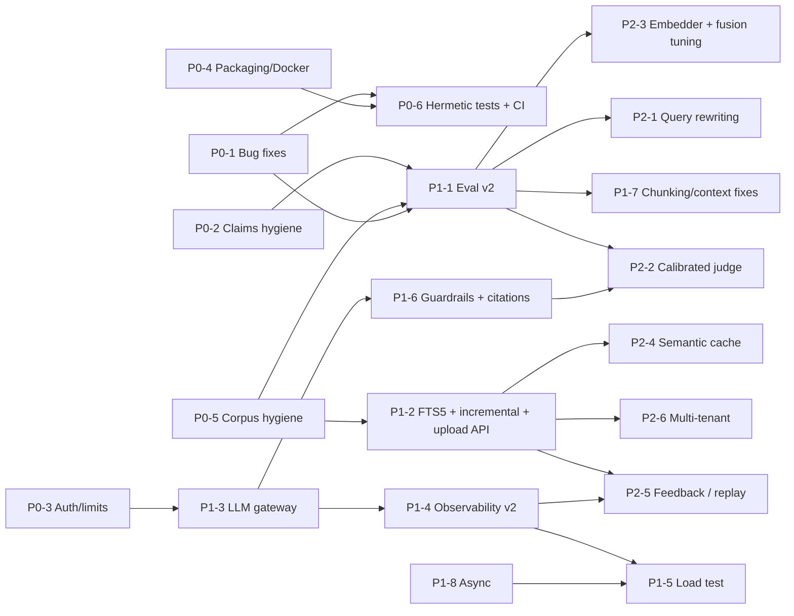

> **UNVERIFIED: written before the rebuild. Do not quote. See docs/CLAIMS_LOG.md.**

# 05 — Improvement Roadmap

**Principle:** five exceptionally executed workstreams beat twenty superficial features. Everything below is justified by a finding in `03_CODE_REVIEW.md` (IDs in brackets) or a gap in `04_MISSING_FEATURES.md`.
**Effort** = focused engineering hours for one person who already knows the codebase (±30%).
**Do not update the resume or README claims until P0-2 is complete.**

---

## 1. The 5 highest-ROI workstreams

| Rank | Workstream | Bundles | Hours | Why it wins |
|---|---|---|---|---|
| **1** | **Trustworthy retrieval + evaluation** | P0-1 (bugs) + P0-2 (claims) + P0-5 (corpus hygiene) + P1-1 (eval v2) | ~58 | Fixes the issues that most damage credibility (R-01, I-01, E-01…E-04) and produces defensible numbers with CIs. Every other claim depends on it. |
| **2** | **LLM reliability gateway with chaos tests** | P0-3 (auth/limits) + P1-3 | ~30 | Turns a broken fallback (L-01) into your strongest systems story: retries, breaker, pre-first-token failover, typed SSE errors, no error caching, cost/TTFT metrics. Demonstrable live ("kill Groq, answer still arrives"). |
| **3** | **Real ingestion lifecycle** | P1-2 (FTS5 + incremental + versioning + upload API) | ~28 | Fixes R-02/I-04, enables async upload, deletion and re-indexing, removes the biggest scalability bottleneck, and completes the "Upload → Response" lifecycle the project claims. |
| **4** | **Reproducible deployment + load/capacity testing + observability** | P0-4 + P0-6 (CI) + P1-4 + P1-5 | ~48 | Docker compose with Prometheus/Grafana/OTel, CI, and a measured capacity report (p95 vs concurrency, Chroma's 10-reads ceiling) is what moves you from Level 2 to Level 3. |
| **5** | **Grounding and safety** | P1-6 + P2-2 | ~28 | Citations, indirect-prompt-injection defences, faithfulness checks on a calibrated judge, red-team cases in the eval set. Differentiates you from "RAG tutorials". |

Total ≈ **190 h** including tests and docs (58 + 30 + 28 + 48 + 28); roughly 14–15 weeks at 13 h/week. The 12-week schedule in §4 covers ≈ 155 h by deferring P1-7 and the second half of the judge calibration. If you only have six weeks, do ranks 1 and 2 plus the deployment half of rank 4.

---

## 2. Prioritised backlog

### P0 — Critical (fundamental bugs, security, credibility)

| ID | Improvement | Current state | Missing implementation | Files affected | Technical approach | Effort | Impact | Interview value |
|---|---|---|---|---|---|---|---|---|
| **P0-1** | Fix correctness bugs with regression tests | R-01 unbounded rerank input; I-01 data loss; L-01 broken Gemini config; L-02 splice; L-03 errors cached | Fixes + tests proving each | `rag/retrieval.py`, `rag/chunkers.py`, `app/main.py`, `tests/unit/*` | Truncate BM25 to top-k and fused list to `rerank_k`; emit leftover small groups; Gemini `http_options` timeout; fail over only before first token; cache only validated `ok` results. Property test: all input text preserved by chunker. | 14 h | **Very high** | "I found and fixed N silent bugs; here are the tests that now guard them." |
| **P0-2** | Claims hygiene: re-measure, remove derived numbers | +44% from estimated baseline; "P50 1.7 s" is mean end-to-end; 12.6 s derived; QPM = 60/latency; error rate literal; README auto-overwritten | Measured baseline (recursive + vector-only); honest metric definitions; artefact-linked README | `eval/feature_contrib.py`, `scripts/run_evaluation.py` (`update_readme`, `build_summary`, `run_observability_eval`), `README.md`, `docs/*`, `resume_bullets_v2.md` | Run the missing arm; compute paired bootstrap CIs; label latency as `retrieval_p50` vs `e2e_p50`; delete `update_readme`; remove FAISS/spaCy docs or regenerate from code; cite file+commit for every number. | 8 h | **Very high** | Eliminates the #1 credibility risk. |
| **P0-3** | Basic API protection | None | API key auth, admin-only flush/metrics, rate limit, input caps | `app/main.py`, `schemas.py`, `cache/cache.py` | `Depends(verify_api_key)`; Redis token-bucket (INCR+EXPIRE or `slowapi`); `Field(max_length=2000)`; body-size middleware; replace `KEYS` with `SCAN`/versioned prefix. | 8 h | High | Answers "what stops abuse?" (S-01, B-02, B-06). |
| **P0-4** | Packaging that actually installs | `pip install -e .` misses imports; polluted freeze; no Docker/CI/.env.example | Minimal deps, lock file, Dockerfile, compose, `.env.example` | `pyproject.toml`, `requirements.txt` (replace), `Dockerfile`, `docker-compose.yml`, `.env.example`, `.github/workflows/ci.yml` | `uv pip compile`/`pip-tools`; extras: `[eval]`, `[dev]`; multi-stage image, non-root, `HEALTHCHECK`; compose: api + redis (+ otel/prometheus/grafana in P1-4). | 10 h | High | "Clone, `docker compose up`, it works." (D-01) |
| **P0-5** | Corpus hygiene: one strategy per collection, filter parity, pagination | 3 strategies mixed; BM25 ignores filters; `get()` unpaginated; stale handle after `clear_collection` | Strategy isolation; consistent filters; correct corpus size | `scripts/ingest_qasper.py`, `db/vectordb.py`, `rag/retrieval.py`, `rag/context_builder.py` | Collection per strategy (`rag_chunks__semantic`); always pass `where`; paginate at 300; `get_collection()` accessor; adjacency by `(doc_id, chunk_idx)`. (Interim fix; P1-2 replaces BM25 storage.) | 10 h | High | (R-02, R-04, R-05, R-09) |
| **P0-6** | Hermetic tests + CI gate | ~35 tests; one wrong; imports need live Chroma/keys; no cache/API/context tests | Fixtures, fakes, CI | `tests/**`, `.github/workflows/ci.yml`, `pyproject.toml` | Lazy/injected clients (see P1-2/B-04 refactor), `fakeredis`, `TestClient` with stubbed LLM, fix `test_latency_is_non_negative`, add tests for R-01/I-01/L-01/L-03; ruff + mypy (core) + pytest `--cov-fail-under=70`. | 12 h | High | Real CI badge; proves bugs are fixed. |

### P1 — High impact (engineering quality and production readiness)

| ID | Improvement | Current state | Missing implementation | Files affected | Technical approach | Effort | Impact | Interview value |
|---|---|---|---|---|---|---|---|---|
| **P1-1** | **Evaluation v2** | Lexical relevance; eval ≠ prod; 100 questions, 71 ≤ 8 words; noisy judge | Doc-id/offset gold labels, paper-scoped + corpus-wide modes, dev/test split, unanswerable set, CIs, same code path as API | `eval/*`, `scripts/run_evaluation.py` (retire), `schemas.py`, `rag/chunkers.py` (offsets in metadata) | Chunk metadata `{doc_id, char_start, char_end}`; relevance = overlap with gold paragraph; metrics: Recall@{1,5,10}, MRR, nDCG@10, "context recall" (what the LLM *actually* saw); paired bootstrap; run dir `evaluation/runs/<UTC>_<sha>/`; compare configs via the same `Retriever` class. | 26 h | **Very high** | "My eval measures what production does, with uncertainty." |
| **P1-2** | **Persistent lexical index + incremental ingestion + versioning + upload API** | In-memory `rank_bm25`; uuid4; wipe-all ingest; no API | SQLite FTS5 (`bm25()`), deterministic IDs, upsert/delete, `doc_version`, `POST /v1/documents` (202 + job) via `BackgroundTasks`, `DELETE`, `index_version` | new `rag/lexical.py`, `rag/ingest.py`, `db/vectordb.py`, `app/main.py`, `rag/retrieval.py` | FTS5 table `(chunk_id, doc_id, tenant_id, text)` with `porter unicode61`; ingestion computes content hash and skips unchanged; batches ≤ 300 for Chroma; fuse top-k lists by RRF; bump `index_version` for cache keys. | 28 h | **Very high** | Real systems design: idempotency, incremental indexing, no new infra. |
| **P1-3** | **LLM gateway** | Direct SDK use; `max_retries=1`; no breaker; SSE absent | Provider interface, backoff+jitter, breaker, deadlines, SSE with `token/sources/error/done`, usage and cost | new `llm/gateway.py`, `app/main.py`, `observability/metrics.py`, `config.yaml` | `tenacity` on 429/5xx/timeouts only; breaker (5 failures/30 s window → open 30 s); first-token deadline + total deadline; `usage` from `stream_options`; price table in config; chaos tests with a fake provider. | 22 h | **Very high** | Resilience and cost story with evidence (L-01…L-06). |
| **P1-4** | Observability v2 | Unlabeled metrics; disconnected spans; no dashboards | FastAPI/httpx/redis OTel, thread context propagation, labels, buckets, Grafana JSON, 2 alert rules | `app/main.py`, `observability/*`, `deploy/{prometheus.yml,grafana/*,otel-collector.yaml}` | Instrument at app factory; `service.name`; stage histograms with buckets sized to measured latency; trace_id in response header; dashboard: RPS, p50/p95/p99 by stage, cache hit rate, tokens/cost, error/failover rate. | 12 h | High | A real trace + dashboard screenshot in README. |
| **P1-5** | Load testing + capacity report | None ("QPM" = 60/latency) | Locust/k6 scenarios, saturation analysis | `loadtest/locustfile.py`, `docs/CAPACITY.md` | Closed-loop users 1→50, 70/30 miss/hit mix, stubbed-LLM mode (isolates retrieval) and real-LLM mode; record RPS, p50/95/99, errors, TTFT, CPU/RAM; find the knee (thread pool vs Chroma's 10 concurrent reads vs LLM rate limit). | 14 h | **Very high** | The missing Level-3 artefact. |
| **P1-6** | Prompt-injection and output guardrails | None | System role, delimited sources, citation IDs, citation validator, red-team set | `rag/retrieval.py::build_prompt` → `llm/prompts.py`, `rag/context_builder.py`, `eval/redteam.jsonl` | `<source id="S1">…</source>` + "treat as data"; require `[S#]`; reject/flag uncited or invalid-ID claims; ingestion-time heuristics (instruction-like text) as *signals*, not filters; 20 adversarial docs in eval. | 14 h | High | Concrete security answer for RAG. |
| **P1-7** | Chunking and context-builder correctness | Window misalignment, truncation, unbounded layout chunks, relevance order lost | Window-aware chunk sizes, re-split oversize sections, relevance-ordered context | `rag/chunkers.py`, `rag/context_builder.py`, tests | Cap chunks ≤ 256 tokens (or swap embedder); sentence/paragraph embeddings with percentile breakpoints; keep `rank` through merge; skip not break on overflow; record `used_chunk_ids`. Re-run ablation on P1-1. | 14 h | Medium–High | Shows you evaluate your own chunker critically; semantic may win or lose, either is a fine story. |
| **P1-8** | Concurrency model | Sync handlers; per-request pool; shared GIL-bound stages | Async I/O path; bounded CPU stages | `app/main.py`, `rag/retrieval.py` | `AsyncOpenAI`, `redis.asyncio`; `asyncio.to_thread` for encode/BM25/rerank behind a semaphore; shared executor; verify on P1-5. | 10 h | Medium | Evidence-based async story ("it helped by X% / it didn't"). |

### P2 — Differentiation (do after P0 and the P1 core)

| ID | Improvement | Why it differentiates | Files | Approach | Effort | Impact |
|---|---|---|---|---|---|---|
| **P2-1** | Query rewriting + multi-turn | Fixes the context-free-question problem; enables chat history | `rag/query_transform.py`, `app/main.py`, `streamlit_app.py` | Standalone-question rewrite with history; optional decomposition; RRF across sub-queries; ablation on P1-1 | 14 h | High |
| **P2-2** | Faithfulness / citation evaluation with a calibrated judge | Makes "do not hallucinate" measurable | `eval/judge.py` | Stronger judge, JSON rubric, 30 human labels → agreement (κ), failures excluded, unanswerable set | 14 h | High |
| **P2-3** | Embedding bake-off + fusion tuning | Likely the single biggest recall lever; evidence-based weights | `eval/sweeps.py`, `config.yaml` | Dev/test split; compare 3 embedders; tune RRF weights/`candidate_k`/thresholds on dev; report test | 10 h | High |
| **P2-4** | Semantic cache with measured false-hit rate | Cost/latency win with honest risk analysis | `cache/semantic.py` | Threshold sweep on paraphrase pairs; key includes `index_version` + config hash | 12 h | Medium |
| **P2-5** | Feedback + trace store + offline replay | Closes the evaluation loop | `app/main.py`, `store/traces.py` | SQLite table of `(request_id, query, chunk_ids, answer, config_id, feedback)`; replay CLI against two configs | 12 h | Medium |
| **P2-6** | Multi-tenant isolation with tests | Strong system-design/security signal | `app/main.py`, `rag/lexical.py`, `db/vectordb.py`, `cache/cache.py` | API key → `tenant_id`; server-side mandatory filter on both legs; cache key includes tenant; cross-tenant leakage tests | 12 h | Medium–High |
| **P2-7** | Adaptive retrieval routing | Latency/cost vs quality, data-driven | `rag/router.py` | Feature-based routes with per-route measured quality; replace LLM router | 10 h | Medium |

### P3 — Optional (adds complexity without proportionate value *for this project*)

| Item | Why skip (and when it becomes justified) |
|---|---|
| Kubernetes / Helm / Terraform | Single-node compose is enough. Justified when you need multi-node autoscaling or must show a cloud deploy; a one-VM deploy script is a cheaper proof. |
| Kafka / Celery / RabbitMQ | `BackgroundTasks` + SQLite jobs table covers the load. Justified when ingestion jobs must survive restarts under concurrent load. |
| Elasticsearch/OpenSearch | FTS5 covers up to millions of chunks on one node. Justified past that, or if you need distributed search/aggregations. |
| Agentic/iterative retrieval | Non-deterministic, hard to evaluate, adds latency. Justified for multi-hop benchmarks (HotpotQA-style), not QASPER-style lookups. |
| LLM-based context compression | Extra LLM call per request. Sentence-level extractive filtering is cheaper if needed. |
| Fine-tuned embedder/reranker; GraphRAG | Big time sink; you'd need training data and a new eval. Only if you want a research-flavoured second project. |
| Online A/B with live traffic | No traffic. Offline replay (P2-5) is the honest version. |

---

## 3. Dependencies between improvements

Key sequencing rules:
* **Never tune retrieval (P1-7, P2-1, P2-3) before Eval v2 (P1-1).** Otherwise you optimise against the lexical, length-biased metric.
* **B-04 (remove import-time side effects) is a hidden prerequisite** for P0-6, P1-2 and P1-8; do it first as part of P0-1/P0-6 ("extract `Retriever` and `LLMGateway` classes").
* **Load-test (P1-5) after observability (P1-4)**, so each run produces traces and dashboards you can screenshot.

---

## 4. Suggested implementation order (12 weeks at ~13 h/week)

| Week | Focus | Exit criterion |
|---|---|---|
| 1 | P0-1 bugs + extract `Retriever`/`LLMGateway` skeletons; P0-6 first tests | R-01, I-01, L-01, L-03 each have a failing-then-passing test |
| 2 | P0-2 claims hygiene (measure the missing baseline arm); P0-5 corpus hygiene | README numbers all trace to an artefact; one strategy per collection |
| 3 | P0-3 auth/limits; P0-4 Docker + compose + `.env.example`; CI green | `docker compose up` works on a clean machine; CI badge real |
| 4–5 | P1-1 Eval v2 | Gold labels by offsets; paired CIs; runs stored with git SHA; paper-scoped and corpus-wide tables |
| 6–7 | P1-3 LLM gateway + chaos tests; SSE | Chaos test: provider A fails → B answers; errors never cached |
| 8–9 | P1-2 FTS5 + incremental ingestion + upload API | Upload → searchable in seconds; re-upload unchanged = no re-embed; delete removes chunks |
| 10 | P1-4 observability + P1-8 async | One screenshot: trace tree + Grafana dashboard |
| 11 | P1-5 load test + capacity doc | Table of RPS/p95/error vs concurrency with the identified knee |
| 12 | P1-6 guardrails + P2-2 judge calibration (+ one P2 item if time: P2-3 embedder bake-off) | Red-team pass rate and faithfulness with CIs in README |

**Stop criteria:** after week 9, you have a project that stands at ~7/10. Weeks 10–12 take it to ~8/10. P2 items are optional and should each come with an ablation, or don't add them.

---

## 5. Effort summary

| Bucket | Hours |
|---|---|
| P0 (6 items) | ~62 |
| P1 (8 items) | ~140 |
| P2 (7 items) | ~84 |
| **Top-5 workstreams only** | **~190 (overlapping P0/P1/P2 items)** |

(The top-5 bundles draw from P0, P1 and P2 so the table totals overlap; plan against the weekly schedule above, not the sum.)
